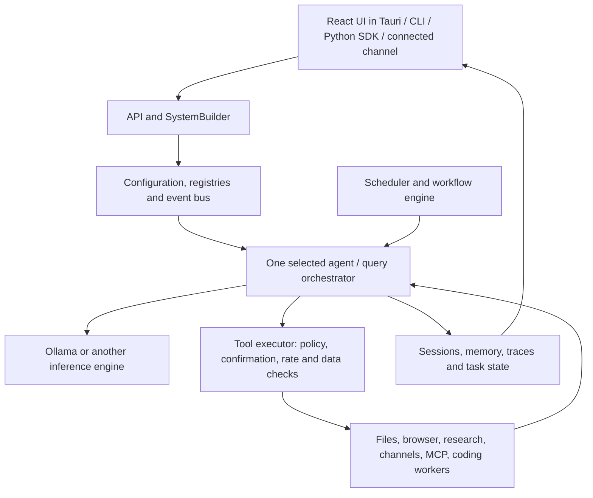

# OpenJarvis adoption review

Reviewed 31 October 2026. Upstream: https://github.com/open-jarvis/OpenJarvis

Pinned review revision: **570d75425d50592d931bac7a17ce6b2621561c06**. Our working baseline is preserved at **acc9426**.

## Decision

**Adopt a pinned OpenJarvis fork as the foundation for the next version. Do not continue independently rebuilding its general agent, memory, speech, and workflow infrastructure.**

Prefer its existing backend **and React/Tauri application** as the eventual product base. Reapply our dark cyan command-center design there and port our verified Mac actions, approval requirements, and acceptance tests. Keep the current Swift app working as a rollback until the replacement passes local acceptance. Keeping Swift permanently would require us to implement and maintain new screens/API bindings for every upstream agent, memory, connector, and settings feature; that is not the fastest route to the owner's broader goal.

This is a recommendation from source inspection, not a claim that upstream is already installed, integrated, secure under every configuration, or proven on this laptop. The immediate next implementation should be a contained compatibility and policy-validation prototype, followed by migration if it passes. No upstream installer or code was executed during this review.

## Review scope and confidence

- Cloned a separate review checkout under `/private/tmp/jarvis-openjarvis-review`; our application and runtime databases were not replaced.
- Inventoried **2,202 tracked files**. Parsed **all 687 Python source files** with Python's AST parser: no syntax errors under the inspection interpreter. This is syntax validation, not Python-version compatibility or runtime validation.
- Python implementation contains approximately **179,277 lines**. The Rust tree contains **124 Rust files / 27,538 lines**. The React source contains **60 TSX files / 20,084 lines**, excluding its additional TypeScript and desktop Rust code.
- Inventoried **716 Python test files** and **7,813 functions named `test_*`**. This is a static count, not the number of collected/passing tests or a coverage measurement.
- Deep-read the composition layer, agent/tool execution paths, OpenCode bridge, authentication, approvals, filesystem policy, subprocess handling, memory, scheduling/workflows, speech, messaging adapters, packaging, frontend structure, and CI configuration. Inspected representative tests for these paths.
- This is a repository-wide architectural and adoption review, **not a line-by-line audit of every function**. The static module/class/function inventory is retained at `artifacts/openjarvis-inventory.json`.
- Did not install dependencies or run their test suite. Our system Python is 3.14, outside upstream's declared range. Rust/Cargo, uv, and Python 3.12/3.13 were not found on PATH. Installation would be a separate implementation action.

## How it works

`SystemBuilder` composes the engine, model, tools, agent, memory, security context and optional services into `JarvisSystem`. The SDK and system expose `ask`; the query orchestrator builds context and selects the execution route. An orchestrator agent repeatedly asks the model for tool calls, dispatches them, appends tool results, and stops on a final response or turn limit. The event bus feeds logging, telemetry and persistent state. The frontend consumes APIs/streams and exposes chat, agents, data sources, settings, dashboard and logs.

The important distinction: an engine runs a model; an agent decides what to call; a tool performs an operation; a channel connects a communication service; a skill is a reusable instruction/workflow. The repository contains working implementations of these boundaries. Their presence does not guarantee a small local model can reliably complete an arbitrary large project.

## Coverage of our roadmap

| Area | What is in the code | Adoption decision |
|---|---|---|
| Local inference | Ollama adapter, streamed responses, engine discovery, alternate local/cloud engines | Reuse Ollama path; explicitly prohibit cloud fallback in our configuration |
| General agent execution | Orchestrator, ReAct, operative/research agents, turn limits, tool resolution | Reuse one bounded agent initially |
| State and scheduling | SQLite agent/task/checkpoint storage, session history, cron/interval/one-shot scheduler | Reuse after interruption and duplicate-side-effect tests |
| Second brain | File ingestion/chunking, FTS retrieval, optional vector backends, fact memory with trust/provenance | Reuse selected-folder ingestion first; automatic fact capture stays off initially |
| Voice | Faster-Whisper local STT, voice I/O, local Kokoro and several cloud speech adapters | Evaluate local push-to-talk first; do not enable paid speech presets |
| Browser and research | Playwright-based tools, web search, deep research and citations | Enable incrementally with scoped profiles and test pages |
| OpenCode | Existing headless HTTP bridge, provider wiring, V1/V2 response handling and cleanup | Reuse after narrowing permissions and enforcing workspace isolation |
| Skills / MCP | Catalog, dependency handling, manifest execution, imports, MCP client/server | Reuse approved local definitions; no arbitrary skill auto-installation |
| Communications | Email, Telegram, Slack, iMessage-related modules, WhatsApp adapters and others | Optional, separately configured, owner-approved sending only |
| Desktop interface | React pages in Tauri, source build and release workflows | Reuse feature screens and apply our design; retire Swift only after parity |
| Agent Factory ambition | Agent manager, templates, skills, workflows and evaluations provide ingredients | Our tested-create-review-register-rollback lifecycle still needs deliberate implementation |
| Independent auditor | Tests, traces and benchmark/evaluation machinery | Retain/add operation-specific verification; generic model output is not proof of task completion |

Supporting source: [system composition](https://github.com/open-jarvis/OpenJarvis/blob/570d75425d50592d931bac7a17ce6b2621561c06/src/openjarvis/system/builder.py), [orchestrator](https://github.com/open-jarvis/OpenJarvis/blob/570d75425d50592d931bac7a17ce6b2621561c06/src/openjarvis/agents/orchestrator.py), [OpenCode adapter](https://github.com/open-jarvis/OpenJarvis/blob/570d75425d50592d931bac7a17ce6b2621561c06/src/openjarvis/agents/opencode.py).

## Findings that materially affect adoption

### 1. Existing approvals are not uniformly human approvals

The generic `ToolExecutor` correctly refuses a confirmation-required tool if no interactive callback is available. However, managed-agent streaming and research paths explicitly pass `interactive=True` with `confirm_callback=lambda _prompt: True`. Capability/rate checks still exist, but this callback automatically accepts the per-tool confirmation. We cannot treat a stock managed-agent session as satisfying our fresh-approval requirements.

**Action:** replace automatic callbacks in every enabled execution entry point with an owner-bound pending-action flow; deny sensitive execution when no UI approval channel is available. Test CLI/API/managed-agent/scheduler/MCP routes separately. A single prompt rule is insufficient.

Evidence: [managed-agent generic executor, lines 1317 onward](https://github.com/open-jarvis/OpenJarvis/blob/570d75425d50592d931bac7a17ce6b2621561c06/src/openjarvis/server/agent_manager_routes.py#L1317), [canonical confirmation gate](https://github.com/open-jarvis/OpenJarvis/blob/570d75425d50592d931bac7a17ce6b2621561c06/src/openjarvis/tools/_stubs.py#L404).

### 2. Safe configuration must be explicit

`CapabilitiesConfig` defaults to disabled and permissive; `SecurityConfig.allowed_dirs` defaults to an empty list, which file tools interpret as unrestricted. Sandbox defaults to disabled. The shared/server security profiles can turn on default-deny RBAC, so the mechanisms exist. The local HTTP middleware also permits keyless operation when no API key is configured, while non-loopback binding has additional checks.

**Action:** our product configuration must set explicit allowed directories, enabled default-deny grants, loopback binding, a nonempty per-launch authentication key, single-worker budgets, no cloud engine, and analytics disabled. Exclude raw shell, external messaging, arbitrary network tools and agent-admin tools until their own approval/isolation tests pass.

Evidence: [security configuration](https://github.com/open-jarvis/OpenJarvis/blob/570d75425d50592d931bac7a17ce6b2621561c06/src/openjarvis/core/config.py#L1423), [filesystem allowlists](https://github.com/open-jarvis/OpenJarvis/blob/570d75425d50592d931bac7a17ce6b2621561c06/src/openjarvis/tools/_paths.py), [authentication](https://github.com/open-jarvis/OpenJarvis/blob/570d75425d50592d931bac7a17ce6b2621561c06/src/openjarvis/server/auth_middleware.py).

### 3. OpenCode is implemented, but its default build permissions exceed our scope

The adapter already drives a local OpenCode server and can point it at our local model. Its default build permission allows editing, bash and web fetching. Setting the working directory alone does not establish an OS sandbox. Its tests exercise config and protocol handling largely with fake clients; that is useful, but not evidence that it can deliver a complex app with our 4B model.

**Action:** retain the adapter, supply restrictive permissions, use an isolated disposable workspace, and test a tiny coding task plus denied filesystem/network actions before enabling it for real projects. Keep an independent build/test verifier.

Evidence: [default permissions](https://github.com/open-jarvis/OpenJarvis/blob/570d75425d50592d931bac7a17ce6b2621561c06/src/openjarvis/agents/opencode.py#L239), [adapter tests](https://github.com/open-jarvis/OpenJarvis/blob/570d75425d50592d931bac7a17ce6b2621561c06/tests/agents/test_opencode_agent.py).

### 4. A concrete shell bridge correctness issue needs a regression test

The Rust shell tool can return a `ToolResult` with `success=false`. Its PyO3 wrapper returns only `result.content`, dropping the success field. The Python fast path then returns `success=True` and `returncode=0` whenever that wrapper returns normally. Reading these paths indicates that a failing shell command can be reported as successful on the Rust-backed path. The Rust path also does not receive the Python wrapper's sanitized environment or requested timeout, and uses blocking `Command.output()`; executor timeout cancellation does not establish process termination.

This is a high-confidence **static finding**, not a live exploit or reproduced runtime test. It directly matters to our verified-outcome goal.

**Action:** keep native shell disabled until structured exit status, environment restrictions, output bounds and child-process termination are preserved across the bridge and tested. Port our bounded process execution behavior where appropriate.

Evidence: [Python wrapper](https://github.com/open-jarvis/OpenJarvis/blob/570d75425d50592d931bac7a17ce6b2621561c06/src/openjarvis/tools/shell_exec.py#L150), [PyO3 wrapper](https://github.com/open-jarvis/OpenJarvis/blob/570d75425d50592d931bac7a17ce6b2621561c06/rust/crates/openjarvis-python/src/tools.rs#L116), [Rust shell implementation](https://github.com/open-jarvis/OpenJarvis/blob/570d75425d50592d931bac7a17ce6b2621561c06/rust/crates/openjarvis-tools/src/builtin/shell.rs).

### 5. Some advanced labels describe building blocks, not completed capabilities

The `agent_spawn` tool in `tools/agent_tools.py` stores metadata in a module-level dictionary and reports running; that function does not instantiate or run an agent. Separately, `AgentManager`/`AgentExecutor` contain real persistent execution machinery. We must use the actual manager path rather than mistake this helper for a completed Agent Factory.

Similarly, evaluation/training modules do not by themselves implement our owner-approved lifecycle for generating, testing, independently reviewing, registering, versioning and retiring capabilities. A skill definition is not evidence that its workflow works.

Evidence: [spawn helper](https://github.com/open-jarvis/OpenJarvis/blob/570d75425d50592d931bac7a17ce6b2621561c06/src/openjarvis/tools/agent_tools.py#L36), [persistent manager](https://github.com/open-jarvis/OpenJarvis/blob/570d75425d50592d931bac7a17ce6b2621561c06/src/openjarvis/agents/manager.py).

### 6. Laptop and packaging fit is plausible, but not zero-effort

Upstream requires Python `>=3.10,<3.14`; our Python 3.14 cannot be used as its supported environment. Use a separate Python 3.13 environment rather than changing our working app's interpreter. Node 24.20.0 and npm 11.19.0 already satisfy the inspected frontend manifest. Core paths such as SQLite memory call the Rust extension; despite legacy docstrings describing a zero-dependency Python backend, that path currently requires the compiled extension.

Start with our existing Ollama/Qwen3 4B setup; do not download larger models merely because examples use them. Upstream's Ollama adapter defaults to a 16,384-token context, whereas our successful measurements used 2,048. Set explicit conservative context/concurrency values, then measure retrieval/tool-loop behavior. A framework upgrade does not increase the model's reasoning ability.

Evidence: [dependency manifest](https://github.com/open-jarvis/OpenJarvis/blob/570d75425d50592d931bac7a17ce6b2621561c06/pyproject.toml), [memory constructor](https://github.com/open-jarvis/OpenJarvis/blob/570d75425d50592d931bac7a17ce6b2621561c06/src/openjarvis/tools/storage/sqlite.py#L45), [Ollama context defaults](https://github.com/open-jarvis/OpenJarvis/blob/570d75425d50592d931bac7a17ce6b2621561c06/src/openjarvis/engine/ollama.py#L78).

### 7. Local-first does not mean every preset is free and offline

The Mac morning-digest example selects a cloud TTS provider and mentions an API key. Local speech alternatives exist. External PostHog analytics is implemented separately from local performance telemetry and defaults to off in the inspected config; it should remain off for our profile. WhatsApp has both a Cloud API adapter and a separate Node/Baileys bridge requiring setup and QR authentication. Neither makes ordinary personal WhatsApp sending immediately available without integration work.

**Action:** enable only local speech and model paths initially, retain explicit account setup and recipient/content confirmation, and leave learning/training, mining, cloud routes, channel auto-replies and automatic imports out of the first migrated build.

Evidence: [Mac preset](https://github.com/open-jarvis/OpenJarvis/blob/570d75425d50592d931bac7a17ce6b2621561c06/configs/openjarvis/examples/morning-digest-mac.toml), [analytics defaults](https://github.com/open-jarvis/OpenJarvis/blob/570d75425d50592d931bac7a17ce6b2621561c06/src/openjarvis/core/config.py#L1211), [WhatsApp bridge](https://github.com/open-jarvis/OpenJarvis/blob/570d75425d50592d931bac7a17ce6b2621561c06/src/openjarvis/channels/whatsapp_baileys.py).

## Maintenance, tests and license

The repository has extensive tests and real CI, including Python/Rust jobs and separate frontend/desktop pipelines. The main CI configuration enforces a 60% coverage floor and excludes live/cloud/hub tests from its default lane. The latest main-push CI run returned by GitHub during review passed at revision `86b83938e723`; recent PR CI runs also passed. **These are not test results for our pinned checkout or our Mac.** A prior main run had failed, so do not treat activity or star counts as a correctness guarantee.

[Observed successful main CI run](https://github.com/open-jarvis/OpenJarvis/actions/runs/40727440952). Published desktop releases exist, but the reviewed branch and release artifacts need separate validation; copying an old release would not necessarily include the inspected source behavior.

The repository declares Apache-2.0. Preserve the upstream license, applicable notices and attribution, and mark modified files when distributing derivative code. Track a real fork/upstream history instead of pasting source into our project and losing provenance. The codebase also contains optional third-party dependencies and model licenses that remain separate considerations.

## Practical transition

1. **Preserve:** retain `acc9426`, our tested `.app`, source, original specs and SQLite history. No destructive rewrite.
2. **Isolated candidate:** create a pinned local fork/branch and a separate Python 3.13 environment. Build the required Rust extension. Use a dedicated OpenJarvis runtime home outside its source checkout and no personal-account connections. Do not run the broad one-line installer against the existing setup.
3. **Minimal runtime:** one Ollama engine and one agent; explicit context/turn/tool budgets; default-deny scoped tools; authentication; analytics/cloud/auto-imports off. Register the four fixed Mac/file adapters.
4. **Acceptance gate:** reproduce all four actions; retain evidence; deny out-of-scope paths; reject unauthenticated calls; verify pending confirmations cannot be self-approved; test Stop All including child termination; test interrupted runs and duplicate confirmations. Add the shell-exit-status regression before enabling any shell capability.
5. **Demonstrate saved work:** add one selected-folder retrieval task with source citations and one local push-to-talk task. Measure peak memory and latency while the actual other Mac apps are open. Our current routing benchmark alone does not establish these workloads fit well.
6. **Migrate product:** make the upstream task/agent runtime the single authority; do not run competing executives. Adapt the existing frontend screens to our command-center theme. Keep old history as a read-only archive initially rather than force incompatible schemas together.
7. **Expand:** browser/research, then restricted OpenCode, then communication drafts/approved sending, then the tested Agent Factory. Each must demonstrate real outcomes on this machine.

If the contained candidate cannot meet the gates without extensive core surgery, stop the wholesale migration and reuse only proven components. That is a rollback criterion, not a reason to spend months recreating the whole framework now.

## Comparison

| Approach | Benefit | Cost | Judgment |
|---|---|---|---|
| Continue fully custom | Small dependency surface; full control | Rebuild agent loops, retrieval, speech, scheduling, connectors and screens | Poor use of effort for the current ambition |
| Copy stock OpenJarvis and enable everything | Fastest superficial feature list | Broad defaults, unverified paths, model/memory cost, conflicting approval behavior | Reject |
| Pinned OpenJarvis fork with focused configuration and patches | Reuses substantial implemented infrastructure while preserving our product requirements | Real integration, policy work, build setup and local validation | **Recommended** |

The current prototype was useful: it proved the native interaction design, scoped actions, cancellation, verification, and a local model on this hardware. It should become a regression baseline and source of reusable behavior—not a reason to reject a stronger foundation.
